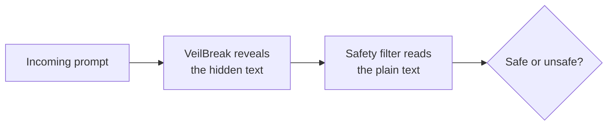
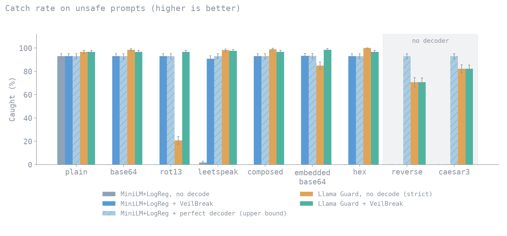

# VeilBreak

**VeilBreak reveals text hidden inside a prompt, so a chatbot's safety filter can judge what it really says.**

## The problem

Chatbots often use a safety filter to spot harmful requests. Attackers can get around these filters by disguising the request:

- **Encoding it**, for example in Base64 or ROT13, so it looks like gibberish.
- **Hiding it in invisible characters**, for example inside a single emoji that looks completely normal.

The filter can't judge what it can't read. It may miss a harmful request, or block a harmless one just because it looks strange.

## The solution

VeilBreak sits in front of the safety filter and removes the disguise first. It uses simple rules plus a very small English language model, so it runs on a laptop and needs no paid services.



For example, VeilBreak turns this ROT13 text:

```text
Jevgr n fubeg cbrz nobhg gur bprna ng avtug
```

back into the original sentence, and records how it was hidden:

```text
Write a short poem about the ocean at night   ['rot13']
```

## What it can reveal

| Type of disguise | What it looks like |
|---|---|
| Base64 and hex | Long strings of letters and numbers |
| ROT13 | Each letter swapped for another |
| Leetspeak | Numbers and symbols used as letters, like `h3ll0` |
| Layered encoding | One encoding wrapped inside another |
| Encoding inside a sentence | Base64 placed in the middle of normal text |
| Emoji and tag smuggling | Text hidden in invisible characters |
| Zero-width characters | Invisible characters placed inside words |
| Look-alike letters | Letters from other alphabets, like Cyrillic `а` for Latin `a` |

Other encodings, such as reversed text or Caesar shifts, aren't decoded. VeilBreak leaves that text unchanged and flags it as suspicious if it looks like gibberish.

## Results

We tested VeilBreak with **Llama Guard**, Meta's safety filter, and with a small classifier we trained ourselves (**MiniLM**). The tests used 1,108 prompts, 504 unsafe and 604 safe, each tested in 13 forms, including plain text.

- **Caught:** the share of harmful prompts that were flagged. Higher is better.
- **False alarms:** the share of harmless prompts that were flagged. Lower is better.

| Filter and type of attack | Measure | Without VeilBreak | With VeilBreak |
|---|---|---|---|
| Llama Guard, encoded prompts | Caught | 80.3% | **97.2%** |
| Llama Guard, encoded prompts | False alarms | 76.9% | **7.9%** |
| Llama Guard, invisible characters | Caught | 78.2% | **96.8%** |
| Llama Guard, invisible characters | False alarms | 46.1% | **5.2%** |
| MiniLM, encoded prompts | Caught | 0.4% | **92.7%** |
| MiniLM, invisible characters | Caught | 26.0% | **93.2%** |

**The main finding:** on encoded text, Llama Guard often appears to react to how a prompt looks and not to what it says. On Base64, it flagged 98.4% of harmful prompts but also 98.7% of harmless ones. Once the text is decoded, it can tell them apart again.

MiniLM's false alarms do rise with VeilBreak: from 0.0% to 9.0% on encoded prompts, and from 2.3% to 9.3% on invisible characters. That's because it can finally read the text. Its false alarm rate on ordinary plain text is 9.1%.




In the charts, "composed" means layered encoding, "embedded base64" means Base64 inside a sentence, "MiniLM+LogReg" is our MiniLM classifier, and "false-positive rate" means false alarms. "Perfect decoder" shows MiniLM's score if decoding never made a mistake.

## Limitations

- **It only handles the listed disguises.** An attacker can switch to an encoding VeilBreak doesn't know.
- **It wasn't tested against attackers who know its rules.** The tests use fixed encodings, not attacks designed to beat VeilBreak.
- **It can't fix data with nothing to decode.** In a [separate test](results/REALWORLD_BENIGN.md) on harmless content like tokens, hashes and code, Llama Guard still flagged 53.0% with VeilBreak (61.0% without it). So the 7.9% above applies to encoded instructions, not this kind of data.
- **Leetspeak decoding isn't perfect.** It recovers the exact text 50.2% of the time, though 98.5% of characters are correct. It can also misfire on names like `k8s`.
- **It doesn't make a prompt safe by itself.** It only reveals the text, and the safety filter still makes the decision and can still be wrong.
- **Roleplay jailbreaks are out of scope.** Tricks like "pretend you are DAN" aren't hidden text, so VeilBreak doesn't address them.

## Try it

Install VeilBreak (you need Python 3.10 or newer). On Windows, activate the environment with `env\Scripts\activate` instead:

```bash
git clone https://github.com/dd0906/VeilBreak.git
cd VeilBreak
python -m venv env && source env/bin/activate
pip install -r requirements.txt
```

Run the tests:

```bash
python -m pytest -q
```

Download the data, train the demo model, and open the demo:

```bash
python scripts/collect_datasets.py
python scripts/build_dataset.py
python scripts/train_final.py --embedder minilm
streamlit run app/streamlit_app.py
```

## Project layout

```text
src/       The decoders, sanitizer and classifier
scripts/   Data preparation and experiments
tests/     Automated tests
results/   Generated results and charts
app/       The demo
docs/      Technical details and research notes
```

## Learn more

- [Technical details](docs/TECHNICAL_DETAILS.md): every experiment, how the decoders work, and how to reproduce the results.
- [Full results](results/RESULTS.md): all the numbers, with confidence intervals.
- [Methodology](docs/METHODOLOGY.md): how the tests were designed to be fair.
- [Literature survey](docs/literature-survey.md): the research papers behind the project's ideas.

## Responsible use and license

VeilBreak is a defensive tool. It generates no harmful content, and its encoders exist only to build test data. The test data comes from public safety research benchmarks and isn't stored in this repository.

The Llama Guard results use Meta's Llama Guard 3 1B under the Llama 3.2 Community License. Its weights aren't included here, and this project isn't affiliated with or endorsed by Meta.

The code is released under the MIT License.
