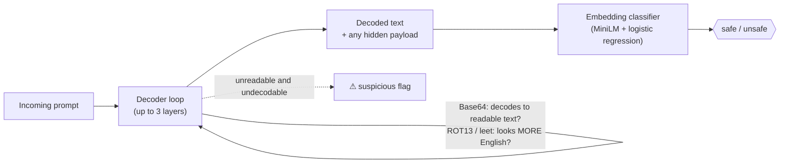
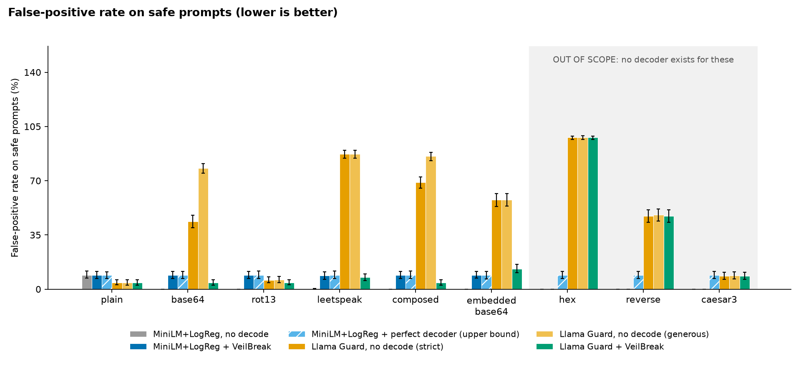

# VeilBreak

**A decode-then-classify defense that stops LLM safety classifiers from being fooled by Base64, ROT13 and leetspeak.**

Safety classifiers read a prompt as plain text, and character-level obfuscation can slip past them: Robust Intelligence (now part of Cisco) [bypassed Meta's Prompt-Guard-86M 99.8 % of the time](https://blogs.cisco.com/security/bypassing-metas-llama-classifier-a-simple-jailbreak) just by spacing out characters, [a study of deployed guardrails](https://arxiv.org/abs/2504.11168) found similar evasions, and [string-composition attacks](https://arxiv.org/abs/2411.01084) show attackers can *stack* encodings. VeilBreak adds a small, deterministic layer in front of any classifier: **detect the encoding → decode it → classify the plain text.** Whether a given guard such as Llama Guard is actually fooled is an empirical question, so the repo includes a head-to-head benchmark.



Nothing is trained on obfuscated text. The classifier only ever sees plain, decoded text; handling encodings is a separate rule-based step. It runs on a laptop CPU (the decoder took ≈0.15 ms per prompt in my measurements) with no paid APIs.

## What it handles

| Input | Example (the sentence *"Write a short poem about the ocean at night"*) | Pipeline output |
|---|---|---|
| Base64 | `V3JpdGUgYSBzaG9ydCBwb2VtIGFib3V0IHRoZSBvY2VhbiBhdCBuaWdodA==` | `base64` → original |
| ROT13 | `Jevgr n fubeg cbrz nobhg gur bprna ng avtug` | `rot13` → original |
| Leetspeak | `Wr!73 4 $h0r7 p03m a80u7 7he 0ce4n 47 n1gh7` | `leetspeak` → original |
| Layered | `SmV2Z3IgbiBmdWJlZyBjYnJ6IG5vYmhnIGd1ciBicHJuYSBuZyBhdnR1Zw==` | `base64` + `rot13` → original |
| Hidden in a sentence | `Here is some data: V3JpdGUg…bmlnaHQ=` | `base64`, payload classified on its own |
| Anything else (hex, reversed, Caesar…) | `thgin ta naeco eht tuoba meop trohs a etirW` | **unchanged + `suspicious` flag** |

## Results

> All numbers below are produced by `scripts/evaluate.py` and copied from [`results/RESULTS.md`](results/RESULTS.md): 5-fold grouped cross-validation, 1,108 prompt groups (504 unsafe, 604 safe) × 9 variants, classifier trained on plain text only. 95 % bootstrap confidence intervals for every cell are in `RESULTS.md`. Llama Guard is `llama-guard3:1b` served by **Ollama (a quantized build)**; the full-precision Hugging Face weights may give slightly different numbers.

**End-to-end**

| System | Catch rate, plain | Catch rate, obfuscated\* | False positives, plain | False positives, obfuscated\* |
|---|---|---|---|---|
| MiniLM + LogReg, no decoding | 93.1 % | **0.4 %** | 9.1 % | 0.0 % |
| MiniLM + LogReg + **VeilBreak** | 93.1 % | **92.7 %** | 9.1 % | 9.0 % |
| MiniLM + LogReg + perfect decoder (upper bound) | 93.1 % | 93.1 % | 9.1 % | 9.1 % |
| Llama Guard, no decoding (strict†) | 96.0 % | 53.9 % | 4.3 % | 52.6 % |
| Llama Guard, no decoding (generous†) | 96.0 % | 64.4 % | 4.3 % | 62.9 % |
| Llama Guard + **VeilBreak** | 96.0 % | **96.4 %** | 4.3 % | **6.7 %** |

\*Average over Base64, ROT13, leetspeak, layered, and hidden-in-a-sentence variants.
†On encoded text, Llama Guard sometimes replies with only a hazard code (`S1`) instead of `unsafe` + code, and it does so on harmless prompts too. So a bare code is not a reliable "unsafe". *Strict* counts it as not flagged, *generous* counts it as flagged; the truth for raw Llama Guard lies in that range.

What the table shows:

- **Decoding closes almost the whole gap for the classifier.** Without decoding, MiniLM catches 0.4 % of obfuscated harmful prompts; with VeilBreak it catches 92.7 %, against a perfect-decoder bound of 93.1 %. False positives stay at the classifier's own plain-text level (9.0 % vs 9.1 %).
- **Raw Llama Guard is not really reading encoded text.** On obfuscated prompts it flags harmless ones about as often as harmful ones (strict: 53.9 % caught vs 52.6 % false positives). Per variant: ROT13 is almost never caught (4.0 %), and leetspeak is "caught" 97.2 % of the time but with 87.1 % false positives.
- **The best system is VeilBreak in front of Llama Guard:** 96.4 % caught and 6.7 % false positives on obfuscated prompts. On plain text, Llama Guard is the stronger classifier (96.0 % vs 93.1 % caught, 4.3 % vs 9.1 % false positives), so the contribution here is the guard-agnostic decoding step, not the MiniLM classifier.
- **Weak spot:** with Llama Guard + VeilBreak, Base64 hidden in a sentence has 13.1 % false positives, roughly three times its 4.3 % on plain text.
- **Out of scope stays out of scope.** VeilBreak decodes no hex, reversed or Caesar text (MiniLM + VeilBreak catches 0.0 % of them). Llama Guard's high hex "catch rate" (99.2 %) comes with 97.8 % false positives, so it is flagging the gibberish, not the harm.




**The decoder on its own (no ML; 1,108 prompts per variant)**

| Variant | Right layers found | Exact text recovered | Character similarity |
|---|---|---|---|
| Plain text (must not be touched) | 100 % | 100 % | 100 % |
| Base64 | 100 % | 100 % | 100 % |
| ROT13 | 100 % | 100 % | 100 % |
| Leetspeak | 100 % | **50.2 %** | 98.5 % |
| Base64 ∘ ROT13 | 100 % | 100 % | 100 % |
| Base64 hidden in a sentence | 100 % | 100 % | 100 % |
| Hex / reversed / Caesar *(unsupported)* | 100 % correctly *not* decoded | – | flagged `suspicious`: 100 % / 99.8 % / 100 % |

- **False triggers on ordinary text:** 5 of 5,201 benign prompts (0.10 %) were altered, all identifiers like `AgNO3` or `Letter1.docx` (dev partition, includes code and URLs).
- **Leetspeak is lossy by nature** (`1` can be `i` or `l`), so exact recovery is ~50 % but 98.5 % of characters are right, which is what the classifier needs. This number is reported honestly rather than rounded up.
- **A finding that shaped the design:** a harmless wrapper sentence ("Decode this and respond: …") dilutes the classifier's signal even with a *perfect* decoder (87 % vs 98 % catch rate in an earlier TF-IDF run; not part of the current `RESULTS.md`). VeilBreak therefore classifies the revealed payload on its own as well and takes the maximum.

## How it works

| Stage | Method | Why this and not something else |
|---|---|---|
| Detect + decode **Base64** | Strict decode; accept only if the result is ≥95 % printable and ≥60 % letters | A random string essentially never decodes to readable text, so no ML is needed and false positives are ≈0. Finds payloads *inside* sentences. |
| Detect + decode **ROT13 / leetspeak** | Apply the decoder; accept only if the result looks clearly **more English** than the input, judged by a tiny character-trigram language model (40 KB) | Any text can be ROT13'd, so there is no structural test; "does it get more English?" is the evidence. Leetspeak is decided token by token, and `1`→`i`/`l` ambiguity is resolved by vocabulary + the language model. |
| **Layers** | Greedy loop (max 3); every step must increase readability or reveal a valid Base64 payload | Guarantees termination; plain and unknown text passes through unchanged (safe fallback). |
| **Classify** | `all-MiniLM-L6-v2` embeddings + logistic regression, trained on **plain** text only | Cheap, CPU-only, explainable. |
| **Suspicious flag** | Not decodable *and* far from English (or a long hex blob) | We can't decode unknown ciphers, but we can say "this looks like one" and let a policy layer decide. |

Thresholds were tuned on a separate **dev** split ([`scripts/tune_thresholds.py`](scripts/tune_thresholds.py)); the ROT13 setting sits in a flat region (100 % recall and 0 false triggers across the whole grid), so it is not fragile.

## Why the evaluation can be trusted

- **Grouped cross-validation.** Every variant of one prompt lives in the same fold; a prompt is never tested on a re-encoding of something it trained on (asserted in code).
- **Plain-text training only**, matching the project's scope: the baseline and the VeilBreak system use the *same* classifier, so any difference is caused by decoding.
- **Benign prompts are obfuscated too**, so "looks encoded" can't be used as a shortcut for "unsafe", and false positives on encoded benign text are measured.
- **Style-matched, length-matched benign set** (half imperative "Write/Create/…", like AdvBench); results are broken down by benign style.
- **Dev/eval split** by prompt hash; the language model never saw evaluation text (fit on Alpaca rows with `index % 5 ≠ 0`, evaluation draws from `% 5 = 0`).
- **Out-of-scope encodings are tested on purpose** (hex, reversed, Caesar) to show the failure mode instead of hiding it.
- **Tests with teeth:** 49 pytest tests including fuzzing; deliberately breaking thresholds or checks makes them fail.

Details: [`docs/METHODOLOGY.md`](docs/METHODOLOGY.md).

## Quick start

```bash
git clone <this repo> && cd VeilBreak
python -m venv env && source env/bin/activate      # Windows: env\Scripts\activate
pip install -r requirements.txt

python -m pytest -q                                 # 49 tests, ~4 s
python -c "from src.pipeline import decode; r = decode('Jevgr n fubeg cbrz nobhg gur bprna'); print(r.decoded, r.encodings)"
```

## Reproduce the results

```bash
python scripts/collect_datasets.py                  # AdvBench, Alpaca, JailbreakBench (needs internet)
python scripts/fit_language_model.py                # writes models/char_lm.npz + vocab.txt
python scripts/build_dataset.py                     # data/processed/veilbreak_v2.csv
python scripts/tune_thresholds.py                   # optional: the dev-split sweep

python scripts/evaluate.py --embedder minilm        # classifier results -> results/RESULTS.md + charts

# Llama Guard comparison via Ollama (local, free; the build is quantized)
ollama pull llama-guard3:1b
python scripts/eval_llamaguard.py --limit 40        # smoke test
python scripts/eval_llamaguard.py                   # full run (~10 min on an RTX 4050)
python scripts/evaluate.py --embedder minilm        # re-run: tables now include Llama Guard
# Optional cross-check with the official full-precision weights (gated: accept the
# licence for meta-llama/Llama-Guard-3-1B on Hugging Face, then `hf auth login`):
#   python scripts/eval_llamaguard.py --backend hf

python scripts/train_final.py --embedder minilm      # model for the demo
streamlit run app/streamlit_app.py                   # interactive demo
```

## Repository layout

```
src/
  encoders.py         # Base64 / ROT13 / leetspeak / layered / embedded (+ out-of-scope encoders for testing)
  language_model.py   # character-trigram "how English is this?" model
  decoders.py         # the decoders (Base64 spans, ROT13, token-level leetspeak)
  pipeline.py         # decode loop, thresholds, suspicious flag
  classifier.py       # embedding + logistic regression; VeilBreakGuard = decode -> classify
scripts/              # data collection, dataset build, tuning, evaluation, Llama Guard runner, demo model
tests/                # 49 tests (units, tricky benign text, composition, fuzzing, dataset integrity)
models/               # char_lm.npz, vocab.txt (tiny, committed)
results/              # generated: RESULTS.md, charts, per-prompt predictions
app/streamlit_app.py  # demo: "without VeilBreak" vs "with VeilBreak" side by side
docs/                 # methodology, design decisions, literature survey
```

## Limitations (read before citing any number)

- **Three encodings only.** Hex, reversed text, Caesar shifts, Morse, homoglyphs, emoji smuggling etc. are not decoded; they are only *flagged* when they look like gibberish. An attacker who knows this can simply pick another encoding; the [cipher-jailbreak literature](https://arxiv.org/abs/2402.10601) shows novel ciphers are exactly where safety training is weakest.
- **Whole-text ROT13 and token-level leetspeak only.** ROT13 applied to a single word inside an otherwise normal sentence is not handled; Base64 is the only encoding detected inline.
- **Leetspeak decoding is approximate** (≈50 % exact, 98.5 % character similarity). Its vocabulary tie-breaker comes from Alpaca, so rare words fall back to the language model.
- **English only.** The "looks more English" test is untested on other languages.
- **The data are direct harmful requests** (AdvBench / JailbreakBench behaviours), *not* templated jailbreak attacks (roleplay, DAN-style, adversarial suffixes), which are explicitly out of scope. AdvBench also contains many near-duplicate prompts, and with 504 unsafe / 604 safe groups the intervals are about ±2 points on the headline numbers and up to ±4 on single variants.
- **Hard benign prompts are a real weakness.** On the "hard" benign style (harmless prompts that sound risky), plain-text false positives are 37.0 % for MiniLM and 20.0 % for Llama Guard (100 prompts; see `RESULTS.md` §4).
- **We measure classifier verdicts, not whether a target LLM would actually follow the decoded instruction.**
- **Llama Guard is judged against dataset labels**, while it was trained on its own hazard taxonomy; its numbers depend on model version, prompt format and backend. Results here use the quantized Ollama build of `llama-guard3:1b`, not the full-precision weights, and raw Llama Guard is reported as a strict/generous range because of bare hazard-code replies (see the Results footnote).
- **Adaptive attackers** who craft inputs against these specific thresholds were not evaluated.

## Related work

[Plentiful Jailbreaks with String Compositions](https://arxiv.org/abs/2411.01084) (attack: composable invertible encodings) · [Bypassing LLM Guardrails](https://arxiv.org/abs/2504.11168) (evasion attacks vs. prompt-injection / jailbreak detectors) · [When "Competency" in Reasoning Opens the Door to Vulnerability](https://arxiv.org/abs/2402.10601) (cipher jailbreaks) · [Broken-Token](https://arxiv.org/abs/2510.26847) (detecting obfuscation via characters-per-token; a natural drop-in for the detector) · [Recover, Decode, Reguard](https://arxiv.org/abs/2607.26574) (closest defense; ML-based recovery for vision-language models, whereas VeilBreak is deterministic, text-only and laptop-runnable) · [JailbreakBench](https://arxiv.org/abs/2404.01318). Full notes in [`docs/literature-survey.md`](docs/literature-survey.md).

## Ethics and data

The datasets contain short descriptions of harmful tasks (public benchmarks used for safety research). VeilBreak generates no harmful content and is a defensive tool; the encoders exist only to build test data.

## License

MIT
