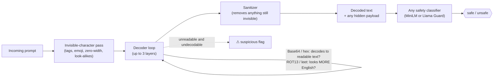
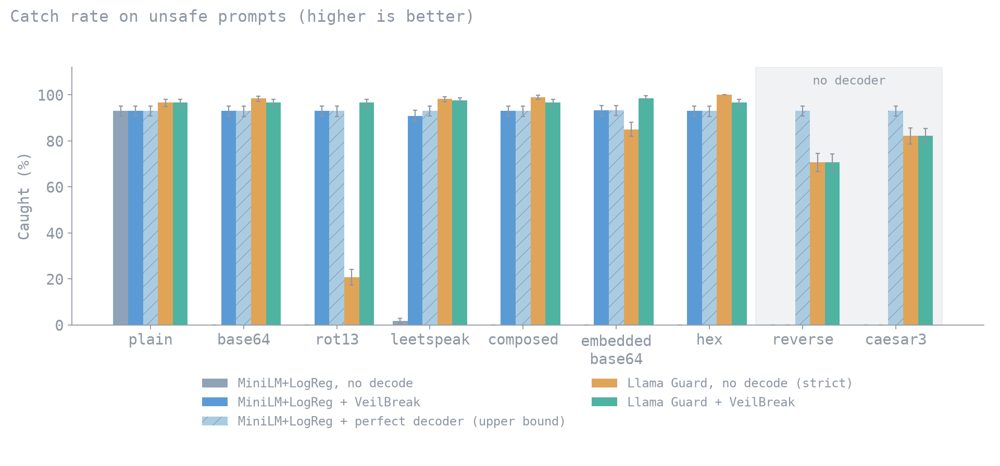
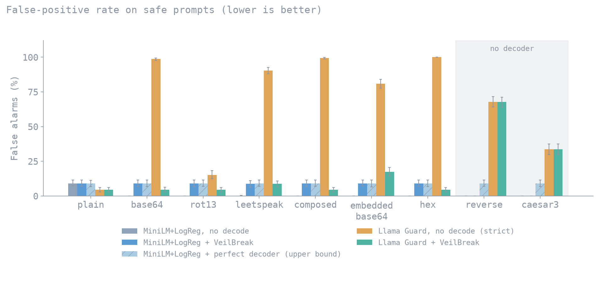
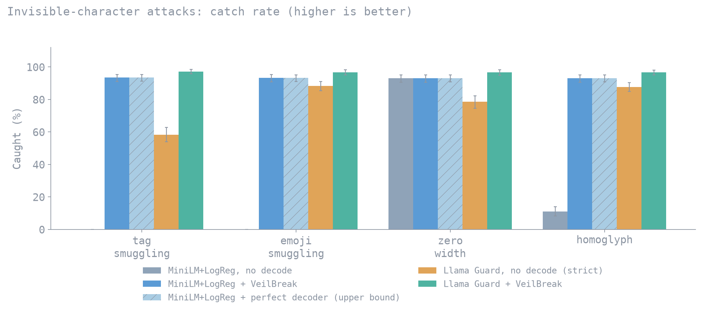
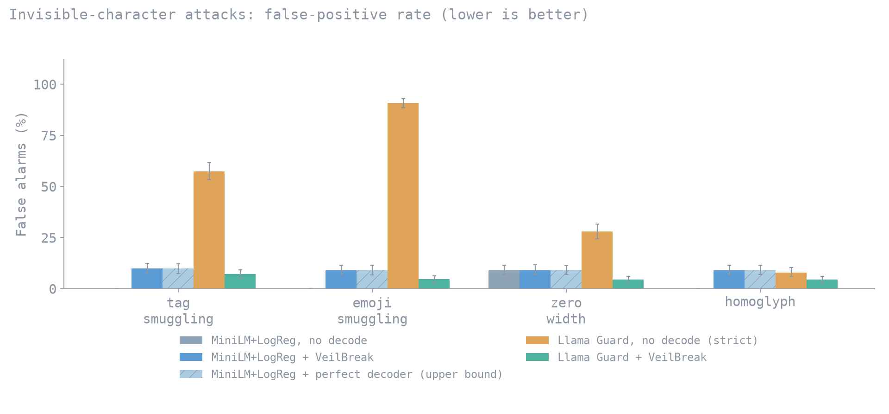

# VeilBreak: technical details

**A decode-then-classify defense that reveals what is hidden in a prompt, so an LLM safety filter can judge what it really says.**

Safety classifiers read a prompt as plain text, and character-level tricks can slip past them: Robust Intelligence (now part of Cisco) [bypassed Meta's Prompt-Guard-86M 99.8 % of the time](https://blogs.cisco.com/security/bypassing-metas-llama-classifier-a-simple-jailbreak) just by spacing out characters, [a study of deployed guardrails](https://arxiv.org/abs/2504.11168) found similar evasions, and [string-composition attacks](https://arxiv.org/abs/2411.01084) show attackers can *stack* encodings. VeilBreak adds a small, deterministic layer in front of any classifier: **reveal hidden text → decode it → classify the plain text.**



Nothing is trained on obfuscated text. The classifier only ever sees plain, decoded text; handling encodings is a separate rule-based step. It runs on a laptop with no paid APIs.

## What it handles

| Input | Example (the sentence *"Write a short poem about the ocean at night"*) | Pipeline output |
|---|---|---|
| Base64 | `V3JpdGUgYSBzaG9ydCBwb2VtIGFib3V0IHRoZSBvY2VhbiBhdCBuaWdodA==` | `base64` → original |
| Hex | `577269746520612073686f7274…` | `hex` → original |
| ROT13 | `Jevgr n fubeg cbrz nobhg gur bprna ng avtug` | `rot13` → original |
| Leetspeak | `Wr!73 4 $h0r7 p03m a80u7 7he 0ce4n 47 n1gh7` | `leetspeak` → original |
| Layered | `SmV2Z3IgbiBmdWJlZyBjYnJ6IG5vYmhnIGd1ciBicHJuYSBuZyBhdnR1Zw==` | `base64` + `rot13` → original |
| Hidden in a sentence | `Here is some data: V3JpdGUg…bmlnaHQ=` | `base64`, payload classified on its own |
| Emoji smuggling | A single 😊 whose invisible variation selectors carry the sentence | `emoji_smuggling` → original |
| Tag smuggling | Normal text followed by invisible Unicode tag characters | `tag_smuggling` → carrier + original |
| Zero-width / look-alikes | Invisible characters inside words, or Cyrillic `а` for Latin `a` | `zero_width` / `homoglyph` → original |
| Reversed, Caesar and other unknown encodings | `thgin ta naeco eht tuoba meop trohs a etirW` | **unchanged + `suspicious` flag** |

## Results

> Numbers are generated, not written by hand. The main tables come from [`results/RESULTS.md`](../results/RESULTS.md) (5-fold grouped cross-validation, 1,108 prompt groups: 504 unsafe, 604 safe, × 13 variants, classifier trained on plain text only). Each experiment below names its own generated file. 95 % bootstrap confidence intervals are in those files. Llama Guard is Meta's **official `Llama-Guard-3-1B` weights** run through `transformers`.

**End-to-end, encoded prompts**

| System | Caught, plain | Caught, encoded\* | False alarms, plain | False alarms, encoded\* |
|---|---|---|---|---|
| MiniLM + LogReg, no decoding | 93.1 % | **0.4 %** | 9.1 % | 0.0 % |
| MiniLM + LogReg + **VeilBreak** | 93.1 % | **92.7 %** | 9.1 % | 9.0 % |
| MiniLM + LogReg + perfect decoder (upper bound) | 93.1 % | 93.1 % | 9.1 % | 9.1 % |
| Llama Guard, no decoding | 96.6 % | 80.3 % | 4.5 % | **76.9 %** |
| Llama Guard + **VeilBreak** | 96.6 % | **97.2 %** | 4.5 % | **7.9 %** |

\*Average over Base64, ROT13, leetspeak, layered, and hidden-in-a-sentence variants. "False alarms" here means harmless *instructions* in encoded form; see [real-world content](#harmless-real-world-content) for data like tokens and hashes.

**Invisible-character attacks** (same classifier, no retraining)

| Attack | MiniLM alone, caught | MiniLM + VeilBreak, caught | Llama Guard alone: caught / false alarms | Llama Guard + VeilBreak: caught / false alarms |
|---|---|---|---|---|
| Tag smuggling | 0.0 % | 93.5 % | 58.3 % / 57.5 % | 97.2 % / 7.3 % |
| Emoji smuggling | 0.0 % | 93.3 % | 88.3 % / 90.9 % | 96.6 % / 4.6 % |
| Zero-width characters | 93.1 % | 93.1 % | 78.6 % / 28.0 % | 96.6 % / 4.5 % |
| Look-alike letters | 11.1 % | 93.1 % | 87.7 % / 7.9 % | 96.6 % / 4.5 % |
| **All four** | **26.0 %** | **93.2 %** | **78.2 % / 46.1 %** | **96.8 % / 5.2 %** |

What the tables show:

- **Decoding closes almost the whole gap for the classifier.** MiniLM goes from 0.4 % to 92.7 % on encoded prompts, against a perfect-decoder bound of 93.1 %, and false alarms stay at its plain-text level. Reaching those numbers took no retraining.
- **On encoded text, Llama Guard's catch rate is mostly an illusion.** It flags harmless prompts almost as often as harmful ones: on Base64, 98.4 % caught against 98.7 % false alarms; on emoji smuggling, 88.3 % against 90.9 %. On plain text it separates them well (96.6 % against 4.5 %). It appears to react to "looks encoded", not to harm. Decoding restores its judgement.
- **The contribution is the guard-agnostic decoding step, not the MiniLM classifier.** On plain text Llama Guard is the stronger classifier (96.6 % vs 93.1 % caught, 4.5 % vs 9.1 % false alarms).
- **Weak spot:** with Llama Guard + VeilBreak, Base64 hidden in a sentence has 17.4 % false alarms, about four times its plain-text rate.
- **New encodings need a new decoder, not retraining.** Hex was added after the original evaluation: Llama Guard's false alarms on hex fell from 100.0 % to 4.5 %, with 96.6 % still caught, and MiniLM went from 0.0 % to 93.1 % caught.
- **Unsupported encodings stay unsupported.** VeilBreak does not decode reversed or Caesar text. Llama Guard alone still catches 70.6 % and 82.1 % of them, with 67.7 % and 33.6 % false alarms.






**The decoder on its own (no ML; 1,108 prompts per variant)**

| Variant | Right layers found | Exact text recovered | Character similarity |
|---|---|---|---|
| Plain text (must not be touched) | 100 % | 100 % | 100 % |
| Base64, hex, ROT13, layered, hidden in a sentence | 100 % | 100 % | 100 % |
| Tag and emoji smuggling, zero-width, look-alikes | 100 % | 100 % | 100 % |
| Leetspeak | 100 % | **50.2 %** | 98.5 % |
| Reversed / Caesar *(unsupported)* | 100 % correctly *not* decoded | – | flagged `suspicious`: 99.8 % / 100 % |

Leetspeak is lossy by nature (`1` can be `i` or `l`), so exact recovery is about 50 %, but 98.5 % of characters are right, which is what the classifier needs.

### Harmless real-world content

The benchmark's harmless samples are encoded *instructions*. Real people paste images, tokens, hashes and code, so [`results/REALWORLD_BENIGN.md`](../results/REALWORLD_BENIGN.md) tests 1,280 harmless samples in 16 categories (tokens are randomly generated). Every flag is a false alarm:

| System | Flagged |
|---|---|
| Llama Guard alone | 61.0 % |
| Llama Guard + VeilBreak | **53.0 %** |
| MiniLM alone | 0.3 % |
| MiniLM + VeilBreak | **1.9 %** |

- **VeilBreak can't fix what can't be decoded.** A JWT stays flagged 98.8 % of the time and a SHA-256 hash 58.8 %, with or without VeilBreak. So the 76.9 % → 7.9 % result applies to encoded instructions, not to opaque data.
- **The decoder is well behaved on opaque data.** It changed none of the random bytes, images, JWTs, tokens, UUIDs or hashes.
- **It does misfire on identifiers.** The leetspeak decoder fired on 54 of 80 samples of names like `k8s` and `h3ll0_w0rld`. That list includes deliberately leet-like names, but it is a real weakness.
- **Non-English text and emoji raised no false alarms** in any system. The plain-text rows use this README as source, which is about jailbreaks and may inflate them.

### Same guard, two builds

[`results/GUARD_BUILDS.md`](../results/GUARD_BUILDS.md) runs the same prompts through Ollama's quantized `llama-guard3:1b` (Q8_0) and the official weights:

| Input | Same verdict | Flagged harmful: Ollama / official | Flagged harmless: Ollama / official |
|---|---|---|---|
| Plain text | 99.1 % | 96.0 % / 96.6 % | 4.3 % / 4.5 % |
| Base64 | **43.8 %** | 40.7 % / 98.4 % | 43.7 % / 98.7 % |
| Layered | 70.8 % | 71.4 % / 99.0 % | 68.9 % / 99.3 % |
| Caesar | 55.2 % | 13.7 % / 82.1 % | 8.6 % / 33.6 % |

**Builds that match on plain text can diverge sharply on encoded text**, so testing a guard build on ordinary prompts alone would miss it. [`results/GUARD_FORMAT_TEST.md`](../results/GUARD_FORMAT_TEST.md) rules out the whitespace differences in the prompt format. The rest of the software stack is not ruled out, so this shows a difference between *builds*, not that quantization alone caused it.

### The Exposure Map: what can a model actually read?

An encoding is only dangerous if the target model can read it and the guard cannot. [`results/EXPOSURE_MAP.md`](../results/EXPOSURE_MAP.md) asks three sizes of Qwen2.5 to write out what an encoded **harmless** sentence says (200 per encoding; replies are not stored). Share at least partly read (similarity ≥ 0.50):

| Encoding | 0.5B | 1.5B | 3B |
|---|---|---|---|
| Plain text (control) | 60.0 % | 83.5 % | 88.0 % |
| Look-alike letters | 84.5 % | 93.0 % | 95.0 % |
| Zero-width characters | 32.0 % | 95.5 % | 93.5 % |
| Leetspeak | 41.5 % | 72.5 % | 90.5 % |
| ROT13 | 1.0 % | 2.0 % | 1.0 % |
| Caesar | 1.0 % | 2.5 % | 0.0 % |
| Hex | 0.0 % | 0.5 % | 2.0 % |
| Base64, layered, reversed, tag and emoji smuggling | 0.0 % | 0.0 % | 0.0 % |

For small open models, **reading ability depends on the type of trick**: visible tricks are readable and generally improve with size, while encoded and invisible-character attacks are almost entirely unreadable. Naming the encoding barely helps the 3B model ([`results/EXPOSURE_HINT.md`](../results/EXPOSURE_HINT.md), 50 prompts): hex reached 16.0 % partly read, ROT13 2.0 %, the rest 0.0 %, and none were fully recovered. This does not generalise to larger models: [CipherBench's authors](https://arxiv.org/abs/2402.10601) report GPT-4o decoding Base64 and ROT13 almost perfectly, while Llama-3.1-8B-Instruct, like our small models, decodes neither.

### Tried and not adopted

Reported because a rejected idea is still a result:

- **Threat-aware decoding** ([`results/THREAT_AWARE.md`](../results/THREAT_AWARE.md)): skip encodings the target can't read. False alarms fall from 5.4 % to 2.2 %, mostly because fewer encodings are checked, and 62.5 % of harmful prompts then pass unchecked, safe only while that exact model can't read them. **Conclusion: keep decoding everything.**
- **Masking undecodable blobs** ([`results/MASKING.md`](../results/MASKING.md), run before hex became a real decoder): real-world false alarms fall from 52.9 % to 20.0 %, but Base32 attacks go from 100.0 % caught to 0.0 %. The 100.0 % was itself a blanket block, since harmless Base32 was flagged 100.0 % too. Not adopted as the default.
- **More training data** ([`results/TRAINING_DATA.md`](../results/TRAINING_DATA.md)): adding XSTest and HarmBench raised MiniLM's JailbreakBench catch rate from 68.5 % to 87.7 % (90.4 % at the threshold chosen on the tune set), but false alarms on safe-but-risky-sounding prompts rose from 37.0 % to 52.0 % (64.0 %). A trade-off, not an improvement, so the demo keeps the baseline model.

## How it works

| Stage | Method | Why this and not something else |
|---|---|---|
| **Invisible characters** | Reveal tag and variation-selector text, strip zero-width characters, map look-alike letters | These are exact or near-exact to undo, and they can wrap any other encoding, so they run first. |
| Detect + decode **Base64 / hex** | Strict decode; accept only if the result is ≥95 % printable and ≥60 % letters | A random string or hash essentially never decodes to readable text, so no ML is needed. Finds payloads *inside* sentences. |
| Detect + decode **ROT13 / leetspeak** | Apply the decoder; accept only if the result looks clearly **more English** than the input, judged by a tiny character-trigram language model (40 KB) | Any text can be ROT13'd, so there is no structural test; "does it get more English?" is the evidence. Leetspeak is decided token by token, and `1`→`i`/`l` ambiguity is resolved by vocabulary + the language model. |
| **Layers** | Greedy loop (max 3); every step must increase readability or reveal a valid payload | Guarantees termination; plain and unknown text passes through unchanged (safe fallback). |
| **Sanitizer** | Default-deny: removes every character on a defined invisible list, except newline and tab | The decoders only reveal schemes they know. This catches the rest. |
| **Classify** | `all-MiniLM-L6-v2` embeddings + logistic regression, trained on **plain** text only. Revealed payloads are also judged on their own | Cheap, CPU-only, explainable. A harmless wrapper or a leftover emoji must not dilute a hidden payload. |
| **Suspicious flag** | Not decodable *and* far from English (or a long hex blob) | We can't decode unknown ciphers, but we can say "this looks like one" and let a policy layer decide. |

**The sanitizer's guarantee** is narrow and checked on every Unicode code point (about 1.1 million), not a sample: its output contains no character on the invisible list (Unicode's `Default_Ignorable_Code_Point`, categories Cf, Cc, Co, Cs and Cn, and the blank Braille pattern). There are deliberately no emoji exceptions, because joiners could carry hidden bits, so a family emoji becomes three emoji and some Persian and Indic words lose their joiners. It does **not** promise that a prompt is safe: look-alike letters are visible characters, and spaces or combining marks can still carry data.

Thresholds were tuned on a separate **dev** split ([`scripts/tune_thresholds.py`](../scripts/tune_thresholds.py)); the ROT13 setting sits in a flat region (100 % recall and 0 false triggers across the whole grid), so it is not fragile.

## Why the evaluation can be trusted

- **Grouped cross-validation.** Every variant of one prompt lives in the same fold; a prompt is never tested on a re-encoding of something it trained on (asserted in code).
- **Plain-text training only**: the baseline and the VeilBreak system use the *same* classifier, so any difference is caused by decoding.
- **Benign prompts are obfuscated too**, so "looks encoded" can't be used as a shortcut for "unsafe", and false alarms on encoded benign text are measured.
- **Style-matched, length-matched benign set** (half imperative "Write/Create/…", like AdvBench); results are broken down by benign style.
- **Dev/eval split** by prompt hash; the language model never saw evaluation text (fit on Alpaca rows with `index % 5 ≠ 0`, evaluation draws from `% 5 = 0`).
- **Unsupported encodings are tested on purpose** (reversed, Caesar) to show the failure mode instead of hiding it.
- **Choices are made away from the test set where possible**: the training-data winner on a tune set, the Exposure Map wording on a plain control from the dev split, masking on a fresh seed with a rule fixed in advance. One exception: the rule that judges an emoji-hidden payload on its own was added after an evaluation number exposed the problem. It only reaches the perfect-decoder bound.
- **Tests with teeth:** 150 pytest tests including fuzzing and the exhaustive sanitizer check.

Details: [`docs/METHODOLOGY.md`](METHODOLOGY.md).

## Quick start

```bash
git clone <this repo> && cd VeilBreak
python -m venv env && source env/bin/activate      # Windows: env\Scripts\activate
pip install -r requirements.txt

python -m pytest -q                                 # 150 tests
python -c "from src.pipeline import decode; r = decode('Jevgr n fubeg cbrz nobhg gur bprna'); print(r.decoded, r.encodings)"
```

The exhaustive sanitizer test uses noticeable CPU and memory, so don't run it alongside a model.

## Reproduce the results

The Llama Guard steps need the gated official weights: accept the licence for `meta-llama/Llama-Guard-3-1B` on Hugging Face, then `hf auth login` with a read token. These steps use a GPU, and the full Llama Guard run took a couple of hours on an RTX 4050 (6 GB). Progress is saved, so a re-run resumes. Run model steps one at a time.

```bash
python scripts/collect_datasets.py                  # public datasets (needs internet)
python scripts/fit_language_model.py                # writes models/char_lm.npz + vocab.txt
python scripts/build_dataset.py                     # data/processed/veilbreak_v2.csv
python scripts/tune_thresholds.py                   # optional: the dev-split sweep

python scripts/eval_llamaguard.py --backend hf --limit 40   # smoke test
python scripts/eval_llamaguard.py --backend hf              # full run
python scripts/evaluate.py --embedder minilm                # results/RESULTS.md + charts

python scripts/evaluate_training_data.py            # more training data
python scripts/train_final.py --embedder minilm     # model for the demo
python scripts/benign_realworld.py                  # harmless real-world content
python scripts/exposure_map.py                      # the Exposure Map (downloads Qwen2.5 models)
python scripts/exposure_hint_test.py                # the same, with the encoding named
python scripts/threat_aware.py                      # threat-aware decoding (no model runs)
python scripts/mask_opaque_test.py                  # masking; policies now differ, see below

streamlit run app/streamlit_app.py                  # interactive demo
```

Two results can't be fully reproduced from the current code alone:
- **Build comparison:** needs `results/llamaguard_predictions_ollama.csv`, the saved Ollama run (also at the first git commit), and `scripts/compare_guard_builds.py`. To regenerate those predictions, use `ollama pull llama-guard3:1b` and `scripts/eval_llamaguard.py --out results/llamaguard_predictions_ollama.csv`.
- **Masking:** `MASKING.md` was generated before hex was added to the pipeline, so a re-run now decodes hex in every policy.

## Repository layout

```
src/
  encoders.py         # every encoding used to build test data
  language_model.py   # character-trigram "how English is this?" model
  decoders.py         # the decoders (Base64, hex, ROT13, leetspeak, invisible characters)
  sanitizer.py        # default-deny removal of invisible characters
  pipeline.py         # decode loop, thresholds, suspicious flag
  classifier.py       # embedding + logistic regression; VeilBreakGuard = decode -> classify
scripts/              # data, evaluation, Llama Guard runner, experiments, demo model
tests/                # 150 tests (units, tricky benign text, composition, fuzzing, sanitizer, dataset)
models/               # char_lm.npz, vocab.txt (tiny, committed)
results/              # generated: RESULTS.md, experiment reports, charts, per-prompt predictions
app/streamlit_app.py  # demo: "without VeilBreak" vs "with VeilBreak" side by side
docs/                 # methodology, literature survey
```

## Limitations (read before citing any number)

- **Only the listed encodings.** Reversed text, Caesar shifts, Morse, Base32, Base85 and custom ciphers are not decoded; they are only *flagged* when they look like gibberish. An attacker who knows this can simply pick another encoding; the [cipher-jailbreak literature](https://arxiv.org/abs/2402.10601) shows novel ciphers are exactly where safety training is weakest.
- **Opaque data still gets over-blocked by Llama Guard** (53.0 % on real-world harmless content with VeilBreak), and no decoder can help when there is nothing to decode.
- **Adaptive attackers were not evaluated.** The attacks are fixed encodings, not inputs crafted against these rules.
- **Whole-text ROT13 and token-level leetspeak only.** ROT13 on a single word in a normal sentence is not handled. Leetspeak decoding is approximate and can misfire on identifiers.
- **The language checks are English-focused.** Harmless non-English text raised no false alarms in the real-world test, but attacks in other languages were not tested.
- **The data are direct harmful requests** (AdvBench / JailbreakBench behaviours), *not* templated jailbreaks (roleplay, DAN-style, adversarial suffixes), which are out of scope. AdvBench contains many near-duplicates and dominates the unsafe set: on plain text MiniLM catches 97.2 % of AdvBench but only 68.5 % of JailbreakBench.
- **Hard benign prompts are a real weakness.** Plain-text false alarms on harmless prompts that sound risky are 37.0 % for MiniLM and 21.0 % for Llama Guard (100 prompts; see `RESULTS.md` §4).
- **We measure classifier verdicts,** not whether a target LLM would follow the decoded instruction.
- **The Exposure Map covers small models only,** with one instruction wording. Small models paraphrase, so read each row against the plain-text control.
- **Llama Guard is judged against dataset labels**, while it was trained on its own hazard taxonomy, and its numbers depend on the build, as shown above.

## Related work

[Jailbroken: How Does LLM Safety Training Fail?](https://arxiv.org/abs/2307.02483) (mismatched generalization) · [Plentiful Jailbreaks with String Compositions](https://arxiv.org/abs/2411.01084) (attack: composable invertible encodings) · [Bypassing LLM Guardrails](https://arxiv.org/abs/2504.11168) (evasion attacks vs. prompt-injection / jailbreak detectors) · [When "Competency" in Reasoning Opens the Door to Vulnerability](https://arxiv.org/abs/2402.10601) (cipher jailbreaks; the template for the Exposure Map) · [Broken-Token](https://arxiv.org/abs/2510.26847) (detecting obfuscation via characters-per-token) · [Blind, Not Weak](https://arxiv.org/abs/2607.26574), first titled *Recover, Decode, Reguard* (closest defense; the target vision-language model does the recovery, whereas VeilBreak is rule-based, text-only and laptop-runnable) · [JailbreakBench](https://arxiv.org/abs/2404.01318). Full notes in [`docs/literature-survey.md`](literature-survey.md). VeilBreak covers a subset of [OWASP LLM01:2025 Prompt Injection](https://genai.owasp.org/llmrisk/llm01-prompt-injection/); it does not solve it.

## Ethics and data

The datasets contain short descriptions of harmful tasks (public benchmarks used for safety research). VeilBreak is a defensive tool that generates no harmful content, and the encoders exist only to build test data. The Exposure Map uses harmless prompts only and stores no model replies.

Llama Guard results use Meta's Llama Guard 3 1B under the Llama 3.2 Community License. This repository does not include its weights, and the project is not affiliated with or endorsed by Meta.

## License

MIT
